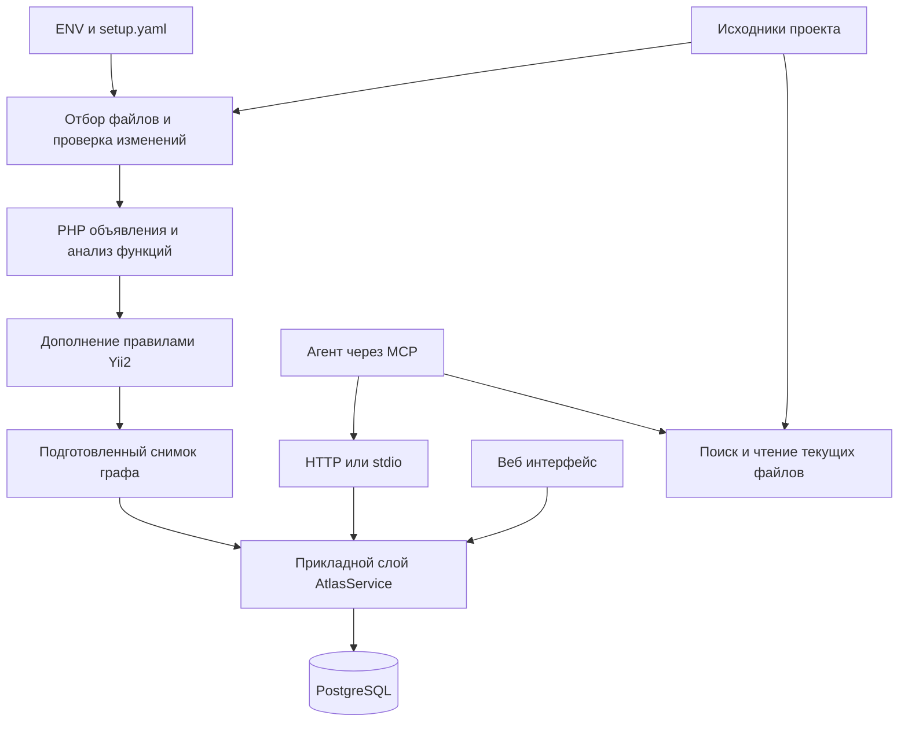

# Как работает Code Atlas

Code Atlas превращает исходники PHP/Yii2-проекта в карту кода. На этой карте можно найти метод, увидеть его вызывающих, проследить чтение и запись свойств, открыть нужные строки и уточнить ошибочную связь. Карта хранится в PostgreSQL и доступна агенту через MCP, а разработчику — через браузер.

Ниже описана текущая реализация. Установка и полный перечень настроек находятся в [README.md](README.md); шаблон настроек — в [examples/setup.yaml](examples/setup.yaml).

## 1. Зачем нужна карта кода

Обычный поиск находит строки с `refund`. Но само совпадение ещё не говорит, относится ли оно к нужному классу, является ли вызовом, комментарием или названием другого метода.

Atlas старается связать место использования с конкретным объявлением. Например:

```php
class Checkout
{
    public function cancel(Wallet $wallet, int $amount): void
    {
        if ($amount > 0) {
            $wallet->refund($amount);
        }
    }
}
```

Здесь полезно сохранить несколько разных фактов: существует `Checkout::cancel`, у него есть параметр `$wallet` типа `Wallet`, внутри находится вызов `refund`, а вызов выполняется при `$amount > 0`. Если объявление `Wallet::refund` доступно и тип понятен, место вызова связывается с этим методом.

Тогда вопрос «кто вызывает refund?» получает ответ с владельцем вызова, файлом, строкой и условием. Чтобы проверить сам код, агент открывает соответствующий участок через `atlas_read`.

Atlas делает статический анализ: читает тексты, строит предположения по правилам языка и фреймворка, сохраняет результат. Он не запускает PHP и не наблюдает реальные запросы пользователей.

## 2. Из каких частей состоит система



У частей разные обязанности:

| Часть | Что делает |
| --- | --- |
| Запуск и конфигурация | Читает настройки, проверяет их, подключает БД, выбирает режим работы. |
| Наблюдатель файлов | Вычисляет подписи содержимого и сообщает об изменениях. |
| Координатор индексации | Организует чтение, анализ, проверки целостности снимка и публикацию. |
| PHP-плагин | Понимает поддержанный синтаксис PHP, объявления, типы и операции. |
| Yii2-плагин | Добавляет связи, которые следуют из правил Yii2 и статических конфигураций. |
| AtlasService | Применяет правила доверия, исправлений, контекста и аналитики; управляет транзакциями. |
| Repository | Скрывает детали хранения. Для приложения используется PostgreSQL, в большинстве тестов — память. |
| HTTP/MCP и веб | Принимают запросы, проверяют аргументы и права, показывают результат. |

Языковые плагины возвращают общие вершины, рёбра и диагностики. Прикладному слою не нужно знать, как устроен PHP-парсер. HTTP и stdio используют один обработчик MCP, поэтому правила запросов у них общие.

## 3. Что происходит при запуске

В Docker сначала запускается PostgreSQL. Скрипт ждёт готовности основного TCP-сервера, создаёт расширение `vector`, затем запускает Atlas от пользователя `postgres`. При завершении одного из процессов контейнер заканчивает работу и останавливает второй. PostgreSQL слушает `127.0.0.1` внутри контейнера.

Atlas проверяет корень проекта, подключение к БД, токены, лимиты и выбранные плагины. Затем применяет миграции. В режиме `serve` он открывает HTTP-порт и запускает наблюдение за файлами. Поэтому страница может открыться до завершения первой индексации.

В настройках два источника:

- ENV хранит секреты, подключение к БД, корень проекта, bind/origins и ресурсы процесса/контейнера.
- `<project>/.atlas/setup.yaml` хранит правила анализа, поиска и MCP.

Файл читается при старте и не перечитывается автоматически после каждой правки. Неизвестные ключи отклоняются. Если файл существует, перенесённые в него старые переменные окружения вызывают ошибку с перечнем конфликтующих имён. Без файла сохранена совместимость с прежней ENV-конфигурацией.

Команды `migrate`, `index`, `serve`, `stdio` требуют конфигурации и БД. `plugins` просто показывает встроенные плагины и работает без БД. `healthcheck` проверяет HTTP `/health`; Docker дополнительно проверяет готовность PostgreSQL. Эти проверки не удостоверяют полноту графа.

## 4. Какие файлы попадают в анализ

Atlas начинает с каталогов `index.watch`. При полном включении vendor добавляется его каталог; иначе отдельно подключаются `index.declaration_paths`. Путь всегда рассматривается относительно корня проекта.

Для каждого пути проверяются исключения, тип файла, нахождение внутри корня и расширение. Символические ссылки не обходятся. Каталоги инструментов и файлы `.env`/`.env.*` встроенно закрыты. Пользовательские исключения добавляются поверх этого правила.

Три списка исключений решают разные задачи:

| Настройка | Граф | Текстовый поиск | Чтение строк |
| --- | --- | --- | --- |
| `exclude` | Исключает | Исключает | Запрещает |
| `index.exclude` | Исключает | Сам по себе не исключает | Сам по себе не запрещает |
| `grep.exclude` | Не влияет | Исключает | Сам по себе не запрещает |

Настройки `index.watch` и vendor дополнительно определяют область обхода поиска. `atlas_read` проверяет путь и общие запреты отдельно: наличие файла в графе не обязательно.

Базовый PHP-плагин выбирает PHP-файлы. Yii2 дополнительно принимает `.js`, `.mjs`, `.html`, `.vue`, чтобы искать поддержанные URL-ссылки. Это узкая функция фреймворкового расширения, а не полноценный анализ этих языков. `atlas_grep` может искать и в других текстовых файлах.

При обнаружении файлов вычисляется подпись их содержимого. Изменение времени файла без изменения текста не обязано вызывать новый анализ. Чтобы заметить изменение, наблюдатель читает содержимое выбранных файлов; сам опрос поэтому тоже требует ресурсов.

Размер файла, общий объём текста, число элементов графа и время анализа ограничены. Ограничение времени проверяется в ходе операций, а не через запуск отдельного PHP-процесса с таймером. Для большого проекта область и лимиты нужно подбирать по фактическому объёму.

## 5. Что хранится в графе

Граф — это набор объектов и связей между ними.

**Вершина** описывает объект: класс, интерфейс, трейт, enum, функцию, метод, свойство, константу, параметр, переменную, ветку условия или конкретное место операции. Например `call_site` — место вызова, `write_site` — место записи, `config_key` — ключ конфигурации. Есть и Yii2-сущности для маршрутов, представлений и событий.

**Ребро** связывает два объекта: класс содержит метод, метод наследуется, место вызова обращается к методу, операция читает свойство. У неизвестной цели ребра `to` может быть пустым; само место операции при этом остаётся доступным.

**Диагностика** объясняет затруднение: файл не удалось прочитать, синтаксис не поддержан, цель вызова неизвестна, конфигурация динамическая или сопоставление неоднозначно. Она содержит путь, строку, код и сообщение.

У вершины и ребра есть ID, вид, позиция в исходнике, `metadata`, уровень доверия и ревизия. В `metadata` находятся дополнительные сведения: тип, выражение, условия, источник типа, кандидаты и другие свойства конкретного вида объекта.

Объявления получают семантические ID, например `method:App\Wallet::refund`. Позиция строки хранится отдельно: добавление строк выше метода не должно само по себе создавать новый метод. Для сопоставления изменений используются также структурные отпечатки — fingerprints. Это помогает сохранить связь с исправлениями при сдвиге и некоторых переименованиях.

Место вызова выделяется отдельно от вызываемого метода, потому что у каждого вызова свои аргументы, позиция, получатель и условия. Десять вызовов одного метода — десять разных мест использования одной цели.

## 6. Как PHP превращается в граф

### Разбор и объявления

Сначала текст разбивается на токены — слова, имена, числа, знаки и другие элементы PHP. Структурный парсер выделяет поддержанные объявления, пространства имён, импорты, классы, члены и функции.

Далее строятся общие индексы классов и функций, связи наследования, интерфейсов и traits. Имя `Wallet` разрешается с учётом namespace и `use`. Плагин старается связать доступный через наследование член с его реальным объявлением.

На этом этапе подключаются дополнительные члены от Yii2: например свойство связи ActiveRecord или тип компонента приложения. PHP-анализ получает их через общий контракт, без прямой зависимости от реализации Yii2.

### Типы и поток значений

Затем анализируются тела функций: присваивания, параметры, вызовы, возвраты, ветвления и поддержанные циклы. Анализатор ведёт представление о возможных типах значений и передаёт их дальше по выражениям.

Источниками типов служат объявления PHP, `new`, присваивания, возвраты, проверки условий, PHPDoc и правила фреймворка. Поддержаны объединения типов, элементы массивов, часть обобщений, локальные `@var`, `@property`, `@method`, `@template`. Аннотации используются для уточнения доступных сведений, но могут содержать ошибки самого проекта.

Например, тип `$wallet` помогает разрешить `$wallet->refund()`. Для массива объектов тип элемента помогает понять `$item` внутри `foreach`. После проверки типа внутри ветки возможный набор типов может сузиться.

Возвраты анализируются в два прохода. Первый собирает типы возвращаемых значений; второй использует полученные сведения при анализе вызывающих функций, если объявленный тип и PHPDoc недостаточно информативны. Это улучшает понимание фабрик и цепочек вызовов. Произвольная глубина зависимостей и рекурсивное вычисление типов до полной сходимости не реализованы.

Есть специальные уточнения для распространённых конструкций: `class-string<T>` с `new $class`, `Yii::createObject`, статических карт фабрик и некоторых вызовов с callback. Передача типа возврата callback через метод с неизвестным возвратом — эвристика: она может ошибиться, если метод фактически возвращает другое значение.

### Операции и условия

Анализатор создаёт места вызовов, чтений, записей, присваиваний и их связи. Возвраты и условия сохраняются как сведения функции и графа. Вложенные замыкания учитываются с доступными захваченными значениями; outline может показывать вызовы внутри них.

Условия означают «анализатор увидел операцию под такой веткой». Они не доказывают, что ветка выполнялась на сервере. Так же вычисленный тип не гарантирует реальное значение при каждом запуске.

Разбор и анализ независимых функций используют ограниченный пул рабочих потоков. Результаты сводятся в определённом порядке. Библиотечные файлы из `declaration_paths` дают объявления и типы, но их тела не анализируются, пока не включён полный vendor.

## 7. Как читать уверенность результата

| Значение | Как понимать |
| --- | --- |
| `resolved` | Цель установлена по доступным типам и правилам анализа. |
| `annotated` | Цель найдена через PHPDoc; проверьте правильность аннотации. |
| `candidate` | Есть несколько возможных целей; одна реализация не выбрана. |
| `unresolved` | Данных недостаточно для установления цели. |
| `external` | Цель относится к внешним/встроенным сущностям либо находится вне доступного графа. |
| `undeclared` | При выполненных проверках не найдено объявления члена у возможных владельцев. |

Источник типа (`type_source`) различает `code`, `annotation`, `framework`. Это отдельная характеристика от уровня доверия 1/2/3: доверие описывает, кем знание внесено и подтверждено, а источник типа — откуда анализатор его получил.

Если часть иерархии отсутствует в индексе, может указываться `unindexed_ancestor`. Это объясняет пробел, но само по себе не доказывает, что виновато конкретное исключение vendor.

`undeclared` используется осторожно: неизвестные предки, behaviors и другие возможные объявляющие стороны могут не позволить сделать этот вывод. Вызовы с совпадающим именем, но неизвестным типом получателя могут показываться как возможные name-only callers; при слишком общем имени вместо длинного списка выдаётся счётчик. Их нельзя считать доказанными вызовами нужного класса.

## 8. Что добавляет Yii2

Yii2-плагин работает поверх PHP-фактов и текстов файлов. Он включается отдельно: `index.frameworks: []` оставляет только PHP.

| Механизм | Что Atlas пытается установить |
| --- | --- |
| Getter/setter | Чтение и запись magic property у Yii-компонентов связываются с `getX`/`setX`. |
| Behaviors | Статический массив `behaviors()` помогает найти методы подключаемых классов. |
| Компоненты приложения | `components` в конфигурации задаёт возможные классы `Yii::$app->x`. |
| ActiveRecord relations | Простой `getX()` с `hasOne/hasMany` даёт свойство `x`, тип связанной модели и связь с геттером. |
| ActiveQuery | Информация о модели проходит через поддержанные цепочки query; `batch()` и `each()` помогают типизировать вложенные `foreach`. |
| Params | Поддержанные ключи `params.php` становятся сущностями `config_key`. |
| Представления | Поддержанные `render/renderPartial` связываются с файлами view и передаваемыми параметрами; варианты theme могут оставаться кандидатами. |
| URL | Маршруты из соглашений контроллеров и статических правил связываются с поддержанными URL-обращениями в PHP и фронтенд-файлах. |
| Очереди | Отправка известного job через `push` связывается с его `execute`, сохраняя сведения об очереди. |
| События | Статически понятные `on`, `off`, `trigger` создают события и связи с обработчиками. |

Например, обычный PHP знает о вызове `trigger`. Расширение может дополнительно связать его с методом, зарегистрированным через `Event::on`, если класс события, имя и обработчик понятны статически.

Такая связь показывает возможную передачу управления по правилам проекта. Реальный порядок регистрации, отключение обработчика, runtime-условия и жизненный цикл процесса могут менять фактическое выполнение. В частности, наличие `off` не превращает статический граф в симуляцию времени выполнения.

Динамические конфигурации, вычисляемые имена компонентов, closures и runtime spread могут оставлять несколько кандидатов или неизвестную цель. Atlas не выполняет bootstrap и DI-контейнер, чтобы угадать недостающие значения.

## 9. Как разделяются приложения одного проекта

В Yii2-проекте `frontend`, `backend`, `console` могут иметь разные `Yii::$app` и одноимённые классы. Раздел `areas` связывает эти имена с каталогами.

Каждая вершина внутри области получает её метку. Для вложенных каталогов выбирается наиболее длинный подходящий путь. Классы и функции без namespace получают префикс области; имена с namespace сохраняют свою обычную структуру.

Компоненты приложения анализируются с учётом конфигов своей области, общих областей и конфигов вне всех областей. Общий код может видеть несколько вариантов; Atlas сохраняет неопределённость, когда единственный тип установить нельзя.

`area` помогает ограничить поиск и места вызовов. Это навигационный фильтр, а не разграничение доступа между пользователями. В локальном графе метода `both/out` фильтр сейчас не ограничивает все соседние вершины.

## 10. Как работают обновления

### Первый и полный проход

При первом проходе читается вся выбранная область, строится граф и подготавливается снимок. После перезапуска процесса нужен такой же полный проход: инкрементальная база файлов и объявлений хранится в памяти координатора.

БД при перезапуске сохраняет опубликованный граф, исправления, историю и время публикации. Полный стартовый проход сверяет его с исходниками; это не удаление всей БД.

### Изменения во время работы

Отдельный наблюдатель продолжает сканировать файлы даже во время анализа. После последней правки выдерживается `debounce_ms`. Так несколько последовательных сохранений обычно объединяются в один запуск.

Для инкрементального прохода сравниваются подписи файлов и доступная другим файлам часть объявлений: имена, типы, параметры, возвращаемые типы, наследование и другие свойства. Если поменялось только тело, повторный анализ тел можно ограничить изменёнными файлами. Если поменялся контракт объявления, добавляются файлы с упоминаниями затронутых имён и зависимые классы иерархии.

Область выбирается консервативно по текстовым упоминаниям и структуре объявлений. Если она больше `max(число файлов / 4, 50)`, выбирается полный проход. Это упрощённый механизм зависимостей, а не обещание минимально возможного пересчёта.

Даже при узкой области исходники читаются и объявления собираются заново. Основная экономия — меньше анализа тел и меньше публикуемых данных. Полного дискового кэша синтаксических деревьев между перезапусками нет.

### Защита от меняющихся исходников

После анализа файлы проверяются повторно. Перед публикацией проверка выполняется ещё раз. Если подписи изменились, подготовленный снимок отклоняется и позже выполняется повторная попытка.

Это уменьшает риск записать граф из разных состояний файлов. Файловая система и транзакция PostgreSQL не образуют единую атомарную операцию, поэтому краткое окно новых изменений всё равно возможно. Для него выдача сообщает о незавершённых изменениях, а наблюдатель запускает следующий проход.

### Публикация

Долгий разбор выполняется вне блокировки прикладного слоя. Для сохранения координатор получает доступ к сервису, сопоставляет старые и новые объекты, применяет правила доверия и записывает изменения в транзакции. Читатель получает опубликованное состояние, а не половину подготовленного снимка. Во время самой публикации запросы, которым нужен тот же сервис, могут ждать.

При глобальной ошибке транзакция откатывается. Ошибки чтения или разбора отдельных файлов не считаются доказательством удаления: старые сведения о проблемном файле сохраняются там, где нельзя безопасно подтвердить замену. Отсутствие файла подтверждается отдельно через `NotFound`; ошибка прав доступа не равна удалению.

## 11. Что сохраняется в PostgreSQL

| Таблица | Содержимое |
| --- | --- |
| `atlas_nodes` | Вершины графа в JSONB. |
| `atlas_edges` | Рёбра в JSONB, ссылки на исходную и целевую вершины. |
| `atlas_diagnostics` | Диагностики анализа. |
| `atlas_corrections` | Исправления, состояния проверки и цепочки предшествующих правок. |
| `atlas_deliveries` | Выдачи графовых элементов и их идентификационные снимки. |
| `atlas_meta` | Служебные сведения, включая время успешной публикации. |

Индексы ускоряют поиск по именам, путям, видам и концам рёбер. Ограничения БД проверяют допустимые уровни доверия, ревизии и ссылки на вершины. При удалении вершины связанные рёбра удаляются каскадно.

Расширение pgvector устанавливается в образе, но текущие запросы не создают embeddings и не выполняют векторное сравнение. Поиск работает по именам, выражениям и тексту исходников.

## 12. Как агент получает ответ

Агент подключается по HTTP с агентским токеном или через stdio, запускаемый доверенным процессом. Оба транспорта передают запрос одному MCP-адаптеру. Текущий HTTP-транспорт принимает JSON-RPC на POST, возвращает JSON и не открывает SSE-поток.

Внутри MCP-обёртки результат инструмента — текст. Строки содержат файл, позицию, вид объекта, имя, разрешение цели, ID и ревизию, когда эти сведения нужны. В начале есть `# index` со свежестью графа и ожидающими изменениями. Это позволяет агенту выбирать следующий запрос без загрузки большого JSON-графа.

Практический порядок исследования:

1. `atlas_search` находит нужное объявление. `symbol` полезен для точного имени, `text` — для целого идентификатора, `substring` — для части имени.
2. `atlas_outline` показывает члены, иерархию и прямые вызовы. `sections: ["called_by"]` запрашивает только вызывающих.
3. `atlas_context` с `direction: in` разворачивает дерево вызывающих на несколько уровней. Для класса это дерево использования его членов. Для метода `both/out` возвращает локальные связи.
4. `atlas_grep` проверяет текстовые случаи, которые могли не стать графом: комментарии, строки, конфиги, шаблоны или неподдержанную конструкцию.
5. `atlas_read` открывает конкретные текущие строки для проверки вывода.

`atlas_batch` объединяет до десяти инструментов чтения в одно обращение. Они выполняются последовательно внутри запроса; выигрыш — в числе обращений к инструменту. Ошибка одного подзапроса показывается в его секции, остальные продолжаются. Зависимые запросы, которым сначала нужен ID из предыдущего результата, обычно требуют следующего обращения.

Поиск ранжирует точные имена и объявления выше мест операций. Если есть `next_cursor`, нужно запросить следующую страницу. Курсор следует передавать как получен, без самостоятельного построения. При изменении графа между страницами выдача не является замороженным снимком всего обхода.

Контекст по умолчанию компактный: тяжёлые metadata и диагностики добавляются по запросу. Члены класса не раскрываются целиком в локальном агентском графе, их число может отражаться в `omitted_members`. `max_nodes` и глубина ограничивают обход; места операций учитываются иначе, чем основные сущности, поэтому предел не следует понимать как строгую длину любого списка строк ответа.

`truncated` означает отсечение по лимиту, `depth_limited` — наличие продолжения за границей глубины. `none` в запрошенной секции outline отличается от секции, которую вообще не запрашивали. Тестовые вызывающие скрыты по умолчанию и могут отражаться отдельным счётчиком.

## 13. Почему нужны grep и read рядом с графом

Граф отвечает о последней опубликованной модели. `atlas_grep` и `atlas_read` читают текущие файлы. Между изменением файла и завершением индексации эти два источника могут расходиться: текст уже новый, позиции и связи ещё старые.

`atlas_grep` ищет literal или regex, поддерживает регистр, границы слова, каталоги, glob-фильтры, контекст строк, режимы содержимого/списка файлов/счётчиков и страницы. Он пропускает бинарные файлы, учитывает ограничения размеров и сообщает ошибки/неполноту. `excluded` означает намеренное исключение, `skipped` — пропущенный файл с причиной. Ноль совпадений при неполном обходе не доказывает отсутствие текста во всём проекте.

`atlas_search` с `withGrep: true` добавляет текстовые совпадения, не покрытые графовой выдачей этого запроса. Он ищет и в файлах без вершин. Дополнение имеет свой курсор; его нужно продолжать через `grepCursor`. Большой span класса не должен скрывать все текстовые совпадения внутри класса только потому, что класс оказался в поиске.

`atlas_read` принимает путь и диапазон или ID сущности. Во втором случае диапазон берётся из графа, а текст — с диска. При ожидающих изменениях такой диапазон может требовать уточнения. За один запрос читается до 400 строк; выход за корень, символические ссылки и общие исключения отклоняются.

## 14. Как исправляются знания

Исправление Atlas меняет сохранённое понимание кода. Файл проекта при этом остаётся прежним.

| Уровень | Кто создал знание | Что происходит дальше |
| --- | --- | --- |
| 1 | Анализатор | Может обновляться анализатором или исправляться агентом. |
| 2 | Агент | Действует сразу, ожидает проверки; анализатор сохраняет защищённую семантику. |
| 3 | Разработчик подтвердил | Агент и анализатор не перезаписывают подтверждённую семантику. |

`atlas_correct` принимает существующий ID, актуальную ревизию, причину и patch. Для вершины меняется `metadata`; для ребра дополнительно можно указать существующую цель `to` или `null`. ID, вид, исходную вершину ребра, позиции и доверие произвольно менять нельзя. Создание и удаление через этот инструмент запрещены.

Пример аргументов, где ID и ревизию нужно взять из реального ответа:

```json
{
  "kind": "node",
  "id": "method:App\\Wallet::refund",
  "expected_revision": 7,
  "patch": {"metadata": {"note": "Уточнение после проверки исходника"}},
  "reason": "Проверено определение метода"
}
```

`expected_revision` защищает от перезаписи более свежей правки: если объект изменился, сервис вернёт конфликт. Тогда нужно перечитать состояние и заново решить, применима ли правка.

Веб-проверка показывает очередь и состояния до/после. Подтверждение переводит объект на уровень 3. Отклонение восстанавливает предыдущую семантику и доверие, сохраняя актуальные позиции. Для цепочки исправлений предыдущее может снова стать ожидающим проверки. Если старая цель ребра удалена, откат не создаёт висячую ссылку: возвращается конфликт.

При переиндексации сервис сначала сопоставляет объекты по устойчивым признакам. Сдвиг строк обновляет позицию отдельно. Уникальный fingerprint может помочь при переименовании. Неоднозначное сопоставление защищённого объекта оставляет диагностику, чтобы новое имя не позволило незаметно обойти доверие через удаление и создание.

Защита относится к сохранённой семантике, а не к вечному существованию объекта. Подтверждённое удаление кода может удалить объект любого уровня доверия.

## 15. Что показывает веб

Веб-ресурсы встроены в Rust-бинарник. Браузер получает их от Atlas, вводит reviewer-токен и обращается к reviewer API.

В интерфейсе есть поиск и просмотр связей кода, состояние индексации, ручной запуск полного прохода, проверка исправлений и аналитика. Reviewer API может отдавать более полный граф с диагностикой, чем компактный MCP-ответ агента.

Прогресс хранится отдельно от длительной транзакции сервиса, чтобы опрос состояния мог работать во время публикации. Панель показывает текущий этап, единицы работы, файлы, занятые потоки, время и очередь запуска. Процент и оставшееся время относятся к этапу, а не ко всей индексации. Без достаточных измерений или известного объёма ETA отсутствует.

Если связь потеряна, старый процент не должен выглядеть как продолжающаяся работа. Опрос восстанавливается после временной ошибки; отклонённый токен требует нового подключения. Завершение этапа чтения или анализа ещё не означает готовность: успех появляется после публикации.

Ручная переиндексация объединяет повторные запросы в очередь. Сброс атласа требует reviewer-токена и явного подтверждения; он удаляет также ручные исправления, подтверждения и аналитику, после чего ставит полный проход. Это отдельная разрушительная операция, а не способ обычного обновления.

## 16. Что означает аналитика

MCP `search`, `context` и `outline` записывают выдачу связанных графовых объектов. Вызовы внутри batch учитываются по своим инструментам. Чистый текст `grep/read`, веб-просмотр и индексация в эту статистику не входят.

В одной выдаче ID дедуплицируются. Повторная выдача того же элемента добавляет ещё одно наблюдение. История хранит идентификационный снимок, поэтому удалённый из графа объект может остаться в статистике.

Панель считает число выдач, уникальные вершины/рёбра, временную динамику и рейтинг. Период задаётся в UTC как `[from,to)`: начало включено, конец исключён. Автоматическое удаление истории сейчас не настроено.

Запись означает, что сервер сформировал выдачу. Она не доказывает доставку до приложения клиента, прочтение агентом или использование знания в решении.

## 17. Границы достоверности

PHP-плагин использует собственный ограниченный структурный разбор. Полный синтаксис всех разрешённых версий PHP, полный CFG/SSA и доказательство поведения программы не реализованы. Поддержанные конструкции подтверждаются конкретными тестами; неподдержанные или динамические случаи могут оставлять диагностику и незавершённые связи.

Результат также зависит от области: исключённые файлы и библиотеки без объявлений ограничивают знание о типах и иерархии. Объявления vendor улучшают понимание вызовов, но declaration-only режим не даёт графа выполнения их тел.

В runtime могут подключаться behaviors, вычисляться классы и маршруты, меняться обработчики. Статический граф описывает доступные определения и возможные связи. Отсутствие ребра не является доказательством отсутствия runtime-пути.

В текущем конвейере нет Git blame, истории коммитов и diff. Старые документы и исходное ТЗ содержат такие разделы как историю развития. Наличие PostgreSQL/pgvector также не означает наличия семантического векторного поиска.

## 18. Где искать реализацию и проверки

| Вопрос | Основные файлы |
| --- | --- |
| Запуск, watcher, stdio | `src/main.rs` |
| Настройки и правила доступа к файлам | `src/config.rs`, `src/setup.rs`, `src/project.rs` |
| Снимок, область обновления и публикация | `src/indexer.rs`, `src/analyzer/incremental.rs` |
| Общий граф и контракты | `src/domain.rs`, `src/analyzer/mod.rs`, `src/analyzer/registry.rs` |
| Разбор PHP, выражения, PHPDoc и типы | `src/plugins/php/{tokens,syntax,expression,doc,flow}.rs`, `src/plugins/php/mod.rs` |
| Yii2 | `src/plugins/yii2/`, включая `events.rs`, `urls.rs`, `views.rs`, `params.rs` |
| Прикладные правила и хранение | `src/service.rs`, `src/repository.rs`, `src/postgres.rs`, `migrations/` |
| MCP, представление ответов, grep/read | `src/http.rs`, `src/mcp_text.rs`, `src/grep_search.rs`, `src/glob.rs` |
| Прогресс и логи | `src/progress.rs`, `src/diagnostics_log.rs`, `src/parallel.rs` |
| Веб | `web/index.html`, `web/app.js`, `web/model.mjs`, `web/explore.mjs`, `web/indexing.mjs` |
| Контейнер | `Dockerfile`, `docker/entrypoint.sh`, `docker-compose.yml` |

Rust-тесты покрывают правила сервиса, анализаторы, транспорт, поиск, исправления, инкрементальную индексацию и отдельные механизмы Yii2. Веб-тесты проверяют модели отображения и опрос состояния. Compose-контракты проверяют поставку без запуска контейнера. PostgreSQL-интеграция запускается отдельно на одноразовой БД.

Актуальные команды и результаты проверки этой рабочей копии перечислены в [README.md](README.md#проверки-и-текущие-ограничения). Дизайн и сценарии изменений находятся в [openspec/changes](openspec/changes/); исторические отчёты в `docs/testing-*.md` относятся к своим этапам и не заменяют новый запуск проверок.
