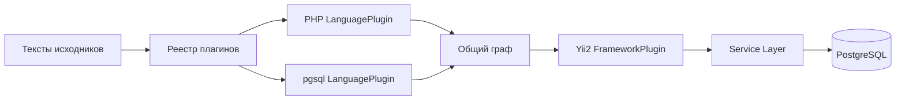

# Плагины Atlas

Плагин учит Atlas анализировать язык или механизм фреймворка. Он реализуется на Rust, включается в бинарник при сборке и не запускает исследуемый код. Runtime языка проекта не нужен.

## Два независимых типа

| Тип | Реализация | Обязанность |
| --- | --- | --- |
| `LanguagePlugin` | `src/plugins/php/`, `src/plugins/pgsql/` | Разбор языка: PHP (объявления, типы, поток) или PostgreSQL/SQL (DDL-файлы и outline DML). |
| `FrameworkPlugin` | `src/plugins/yii2/` | Дополнение PHP-графа правилами Yii2: getter/setter, behaviors и компоненты. |

`src/analyzer/mod.rs` определяет SourceFile, AnalysisOptions и оба trait; `registry.rs` проверяет регистрацию, зависимости и выбор файлов. Service Layer получает общий GraphSnapshot и не зависит от языка. Файлы с ошибкой разбора не используются фреймворковым расширением и не разрешают удалить старые данные.

`index.languages: [php]` и `index.frameworks: [yii2]` в `.atlas/setup.yaml` — значения по умолчанию. Чтобы индексировать `.sql`/`.pgsql`, добавьте `pgsql`: `languages: [php, pgsql]`. `index.frameworks: []` оставляет базовый анализ PHP. Неизвестные ID, дубликаты, конфликтующие расширения и отсутствие языковой зависимости отклоняются до индексации. `code-atlas plugins` показывает каталог встроенных плагинов.

## SQL внутри PHP

Даже без включения `pgsql` в `index.languages` PHP-плагин извлекает raw SQL из строковых аргументов `createCommand`, `findBySql` и `prepare` (литерал или переменная с последним присвоением-строкой). Общий outline (`src/plugins/pgsql/query.rs`) строит:

| Вид | Пример ID / ребра |
| --- | --- |
| `sql_site` | место SQL внутри метода |
| `table` | `table:public.wallet` (схема по умолчанию `public`) |
| `sql_reads` / `sql_writes` | от `sql_site` к таблице (SELECT/FROM/JOIN → read; INSERT/UPDATE/DELETE/TRUNCATE → write) |

CTE-имена (`WITH cte AS …`) не считаются таблицами. SQL не исполняется; динамическая конкатенация без литерала в аргументе API не разбирается.

## Плагин `pgsql` (файлы `.sql` / `.pgsql`)

При `languages: […, pgsql]` файлы с расширениями `sql` и `pgsql` проходят через `PgsqlLanguagePlugin`:

- DDL: `CREATE SCHEMA` / `TABLE` / `VIEW` / `FUNCTION|PROCEDURE` / `INDEX` → узлы `schema`, `table`, `column`, `view`, `function`, `index`, рёбра `contains`, `references`, `indexes`.
- DML в тех же файлах дополнительно даёт `table` через тот же outline, что и SQL-in-PHP.
- Ошибка в одном statement не отбрасывает остальные; `psql` не вызывается.

## Добавление следующего языка

1. Реализовать `LanguagePlugin` в отдельном модуле Rust: `id()`, `extensions()`, `analyze(files, options)`.
2. Преобразовать синтаксис языка в общие Node/Edge/Diagnostic с устойчивыми семантическими ID. Неизвестное не подменять доказанным отсутствием.
3. Учитывать deadline и max_graph_elements, возвращать ошибки при превышении лимитов, не исполнять исходники и не запускать toolchain проекта.
4. Зарегистрировать плагин в `src/plugins/mod.rs`, добавить сценарии и тесты, пересобрать Atlas. После этого включение/выключение уже встроенного плагина выполняется setup/ENV без пересборки.

Для JavaScript, Go, Rust и Python пока предусмотрен контракт расширения, но сами анализаторы не реализованы. Общий реестр протестирован также с тестовым вторым языком, без специальных веток в индексаторе. Динамический ABI для сторонних библиотек не обещается.

## Границы

Статические объявления и доказуемые связи отделяются от кандидатов. Yii2 не исполняет bootstrap, DI-контейнер, closures конфигурации или динамические behaviors. Источник сведений из vendor включается через `index.include_vendor` и `index.declaration_paths` (по умолчанию часто только `vendor/yiisoft`): модели, наследующие базу вне этих путей, всё же получают `X::find()` → `ActiveQuery<X>`, но прочие унаследованные члены без индексированного предка не видны. В `switch` каждый `case`/`default` — отдельная точка входа: `return`/`break` в одной ветке не помечает следующие как `unreachable_after_exit`. Нативный PHP-разбор имеет явно ограниченную область поддержки; SQL-outline покрывает типичный DML/DDL PostgreSQL, а не полную грамматику. Результаты новых тестов и ограничения переноса записываются в отчёте проверки.

Текущие сценарии и границы: [нативный PHP](testing-native-php.md), [pgsql / SQL-in-PHP](testing-native-pgsql.md), [Yii2](native-yii2.md), [runtime и реестр](testing-native-runtime.md).
