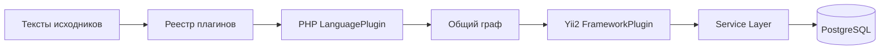

# Плагины Atlas

Плагин учит Atlas анализировать язык или механизм фреймворка. Он реализуется на Rust, включается в бинарник при сборке и не запускает исследуемый код. Runtime языка проекта не нужен.

## Два независимых типа

| Тип | Реализация | Обязанность |
| --- | --- | --- |
| `LanguagePlugin` | `src/plugins/php/` | Разбор PHP, объявления, области, типы, возвраты, связи и неопределённость. |
| `FrameworkPlugin` | `src/plugins/yii2/` | Дополнение PHP-графа правилами Yii2: getter/setter, behaviors и компоненты. |

`src/analyzer/mod.rs` определяет SourceFile, AnalysisOptions и оба trait; `registry.rs` проверяет регистрацию, зависимости и выбор файлов. Service Layer получает общий GraphSnapshot и не зависит от языка. Файлы с ошибкой разбора не используются фреймворковым расширением и не разрешают удалить старые данные.

`index.languages: [php]` и `index.frameworks: [yii2]` в `.atlas/setup.yaml` включают текущие плагины. `index.frameworks: []` оставляет базовый анализ PHP. Неизвестные ID, дубликаты, конфликтующие расширения и отсутствие языковой зависимости отклоняются до индексации. `code-atlas plugins` показывает каталог встроенных плагинов.

## Добавление следующего языка

1. Реализовать `LanguagePlugin` в отдельном модуле Rust: `id()`, `extensions()`, `analyze(files, options)`.
2. Преобразовать синтаксис языка в общие Node/Edge/Diagnostic с устойчивыми семантическими ID. Неизвестное не подменять доказанным отсутствием.
3. Учитывать deadline и max_graph_elements, возвращать ошибки при превышении лимитов, не исполнять исходники и не запускать toolchain проекта.
4. Зарегистрировать плагин в `src/plugins/mod.rs`, добавить сценарии и тесты, пересобрать Atlas. После этого включение/выключение уже встроенного плагина выполняется ENV без пересборки.

Для JavaScript, Go, Rust и Python пока предусмотрен контракт расширения, но сами анализаторы не реализованы. Общий реестр протестирован также с тестовым вторым языком, без специальных веток в индексаторе. Динамический ABI для сторонних библиотек не обещается.

## Границы

Статические объявления и доказуемые связи отделяются от кандидатов. Yii2 не исполняет bootstrap, DI-контейнер, closures конфигурации или динамические behaviors. Источник сведений из vendor включается через `index.include_vendor`. Нативный PHP-разбор имеет явно ограниченную область поддержки; результаты новых тестов и ограничения переноса записываются в отчёте проверки, а старые 153 PHP-проверки не считаются выполненными для новой реализации.

Текущие сценарии и границы: [нативный PHP](testing-native-php.md), [Yii2](native-yii2.md), [runtime и реестр](testing-native-runtime.md).
